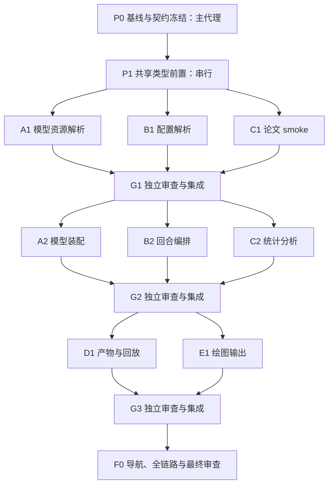

# 仿真与实验子包拆分：Subagent 并行执行计划

> **执行者：** 主代理使用 `subagent-driven-development` 与 `dispatching-parallel-agents` 组织实施。本文只定义未来执行，不表示已开始重构。任务须经过实现、自审、独立审查、集成验证四个环节才能完成。

> **设计选择已确认：** 采用 W2（一个集成 worktree + 每个并发任务独立 worktree）；实验实现保留在 scripts 子包；Episode 以阶段函数组合为主；Stage4 稳定后优先拆诊断离线部分。本轮仅完善计划，尚未启动实施。

**Goal：** 在保持 import、CLI、数值结果与数据语义的前提下，并行拆分仿真与实验子包，建立 README 按需发现路径。

**Architecture：** 先串行冻结契约与共享类型，再以文件独占方式进行三轮迁移。子代理处理领域内部实现，主代理负责共享文件、跨域接线和 Git 集成。保持现有组合设计，不新增继承框架。

**Tech Stack：** Python 3.11+、MuJoCo、NumPy/SciPy、pytest、CodeGraph，无新增运行依赖。

**Spec：** [调查报告](2026-11-20-maintainability-survey.md)与[原拆分计划](2026-11-20-sim-experiment-decomposition.md)。原计划规定目标职责和行为边界；本文替代其任务调度、文件所有权、提交方式与类型迁移顺序。任何新增业务行为不在授权范围内。

## 1. 全局约束与执行条件

- 保留原计划全部行为约束：物理/安全参数、算法、配置优先级、随机数顺序、schema、统计口径不变；不改 Stage4、C++ 核心或历史实验数据。
- Python 函数签名有类型提示；中文注释/docstring；新包有 `__init__.py` 与 README；不用 Mixin、万能 Context、通用插件框架或重复实现完成搬迁。
- 本次方案按四个代理槽位设计：主代理 1 个、工作子代理最多 3 个。审查者也占槽位，不能在三个实现者都运行时再启动第四个子代理。
- 实施前使用适合的隔离 checkout/worktree；若需新建，使用宿主 `create_worktree`，不复用 Stage4 worktree。不在 main 直接启动结构迁移，不覆盖用户未提交文件。
- worktree 采用第 15 节 W2：一个集成目录及最多三个并发任务目录。每个子代理提示词显式写明绝对工作目录；文件所有权规则继续有效。
- 子代理禁止 checkout、merge、rebase、reset、stash、clean、stage、commit、push；主代理在对应任务停止写入后，在其独立 worktree 按明确路径提交。此规则覆盖原技能中的“实现者自行提交”，统一管理审查提交与集成。
- 不自动合并 main、不推送。不得为了获得通过结果自动重试、放宽阈值或跳过失败。
- 本文静态名字只固定跨任务接口；领域内部函数签名由 owner 按实际读写集合确定，写入任务报告后才允许其他任务消费。

## 2. 并行图与关卡



| 轮次 | 可同时实施 | 为什么可以并行 | 为什么保留关卡 |
|---|---|---|---|
| 准备 | P0 → P1 串行 | 共享类型和签名必须只有一个来源 | 类型迁移会同时触及三个旧模块 |
| 第一轮 | A1 / B1 / C1 | 模型、配置、实验入口不同；C1 只消费冻结的旧仿真接口 | 避免把半迁移配置当作新基线 |
| 第二轮 | A2 / B2 / C2 | 模型、回合、统计文件独占；使用上一轮稳定契约 | 模型工厂内部变化需与 Episode 一起验证 |
| 第三轮 | D1 / E1 | 回放/快照与绘图文件独占；依赖均已稳定 | 两者仍需与前面全部产物契约交叉验证 |
| 收口 | F0 主代理 + 只读最终审查 | 不再有实现写入 | 验证 README 路由、全量与小链路 |

此处区分“运行依赖”和“实施依赖”：C1 不必等待整个仿真重构完成，因为它应始终使用不变的公开接口；C2 同理。D1 晚于 B2，是因为它消费 `episode.types` 和模型装配能力，延后可减少跨包接线返工。

实现完毕的任务先标记 `ready_for_review`。该任务停止写入且生成固定提交后，可利用空闲槽位启动只读 reviewer，其他独立任务可继续；所有子代理合计最多三个。审查修改需回到原 owner，禁止 reviewer 直接编辑。整轮关卡仍等待本轮所有任务批准。

## 3. 共享文件与测试的单一所有者

**主代理永久独占：** `AGENTS.md`，根目录两份 README，`docs/README.md`，`src/README.md`，`scripts/README.md`，`src/robot/README.md`，`src/sim/README.md`，`scripts/exp/README.md`，`scripts/extract/README.md`，`scripts/plot/README.md`，本计划及原计划，进度 ledger，`src/sim/v12_robot_adapter.py`，`src/sim/episode_runtime.py`，各 CLI 外部调用者，`scripts/exp/batch_runner.py` 与 `run_catalog.py`。

叶子包 README 由该包 owner 编写；父级 README 通过报告中的“导航补丁建议”交给主代理统一接线。

**所有既有 `tests/test_*.py` 默认由主代理独占修改。** 子代理可以读取和运行；如迁移导致私有 monkeypatch 失效，报告原补丁点、新定义位置及理由，由主代理修改，不能临时改全局 `sys.modules` 或复制旧实现来绕过。新增测试只允许写任务卡列出的精确路径。

每轮开始主代理在 ledger 公布写集。需要改边界外文件时，owner 报告最小补丁建议，继续其余独立工作；主代理在关卡统一修改，或先撤销原 owner 的写权限再重新分配。不同任务不同时编辑同一文件的不同段落。

P1 结束后，类型文件所有权转移给所属任务：`configuration/types.py` → B1，`episode/types.py` → B2，`model_building/types.py` → A2。字段与语义仍冻结，不能单方更改跨任务类型。

## 4. P0：基线、契约、brief 和 ledger（主代理）

- [ ] 记录当前 HEAD、Python/MuJoCo/扩展版本、工作区修改；调查报告的 `20397eb` 仅为历史起点，不强制回退。
- [ ] 按原计划任务 0 跑基线，保存失败 nodeid、skip、错误原因及日志；全量失败要分类，不阻止只读准备，但没有可解释基线不得开始迁移。
- [ ] 更新 CodeGraph；用 `rg` 补查动态导入、`__file__`、全局可变配置、pickle/类型路径、monkeypatch、脚本间导入。记录结果而非只引用图结论。
- [ ] 创建本计划专属 ledger 和 `contracts.md`：路径为 `.superpowers/sdd/sim-experiment-decomposition/` 下的 `progress.md`、`contracts.md`、`briefs/`、`reports/`、`reviews/`；若该目录已存在，先读取身份与状态，不能重置既有进度。
- [ ] `contracts.md` 固定旧路径/新定义路径/签名/类型字段/公有常量/错误语义/调用者/已知补丁点。原计划稳定函数清单必须逐项覆盖；长签名用实际 `inspect.signature` 抄录，不能凭记忆简写。
- [ ] 为 schema、run/config 身份、False/0/None、seed/attempt、meshdir 优先级建立字段级基准。比较默认排除墙钟时间、时间戳和 Git 提交号；源码哈希只允许因迁移而改变，资源哈希、科学配置哈希和运行身份仍需符合原契约。
- [ ] 从原计划目标表、对应原任务、本文任务卡和 contracts 生成每个 brief。子代理只读自己的 brief、必要契约和指定源码，不要求它重新读整个计划。
- [ ] 明确测试资源策略：纯函数测试可并行；所有会创建 MuJoCo/渲染/固定输出或启动批处理的测试由主代理发放单一运行许可。每任务临时输出在 `results/refactor_subpackages/<task-id>/` 或独立 pytest basetemp，不共享结果目录。

**输出：** 可用基线、冻结接口、写集和完整 brief。不存在待补的跨任务接口才能进入 P1。

## 5. P1：共享类型前置（串行任务）

**写集：** `src/robot/model_building/{__init__.py,types.py,README.md}`、`src/sim/configuration/{__init__.py,types.py,README.md}`、`src/sim/episode/{__init__.py,types.py,README.md}`；旧 `model_factory.py`、`v12_config.py`、`v12_episode.py`；新增 `tests/test_refactor_shared_types.py`。

- [ ] 迁移 `RacketAssembly`、`RobotModelBundle`、`ResolvedV12Config`、`V12EpisodeResult` 的唯一类定义；其方法所需的纯辅助函数随类型迁移。不得从 types 反向 import 旧 facade。
- [ ] 原路径显式重导出同一对象；已有数据类字段、默认值、冻结语义和实例方法保持一致。对 `__module__`/pickle 等真实使用进行检查，若存在持久化依赖则明确兼容处理，不假定无人使用。
- [ ] `__init__.py` 暂只暴露必要轻量内容，不引入尚未迁移的实现模块。README 明示当前只完成类型迁移。
- [ ] 运行 `python -m pytest tests/test_refactor_shared_types.py tests/test_v12_config.py tests/test_v12_robot_adapter.py tests/test_r1d_model.py tests/test_robot_package_init.py -q`，另验证新旧类型 `is` 相同。
- [ ] 独立审查并由主代理提交。将新基线 SHA 写入所有第一轮 brief。

**解锁原因：** 消除“产物先拆但 Episode 类型以后才搬”的隐藏依赖，避免三名子代理各定义一份结果/配置类型。

## 6. 第一轮任务卡

### A1：模型资源解析

**对应原任务：** 1。**写集：** `src/robot/model_assets/` 全包（`references.py`、`dependencies.py`、`__init__.py`、README）；`src/robot/model_factory.py`；新增 `tests/test_model_asset_imports.py`。

**输入：** P1 类型与原参数/profile；contracts 中路径解析规则。
**输出：** `model_assets.dependencies.collect_model_file_dependencies`，签名与旧函数完全相同；原 `model_factory.collect_model_file_dependencies` 重导出。`collect_model_dependencies` 暂留原工厂消费新解析器，交 A2 处理。

- [ ] 将引用规则、候选路径、`_AssetReference`、`_walk_model_file` 和依赖收集迁到新包；禁止修改产物模块。
- [ ] 明确纯解析不加载 MuJoCo；记录旧私有 helper 的外部使用和需要主代理修正的调用。
- [ ] 申请重测试许可，运行原任务 1 测试组及新增 import 测试。
- [ ] 提交报告，交出 `model_factory.py` 写权限。A2 仅在 G1 后接手。

### B1：配置解析

**对应原任务：** 4。**写集：** `src/sim/configuration/`（含 P1 类型，字段冻结）、`src/sim/v12_config.py`；新增 `tests/test_configuration_migration.py`。

**输入：** P1 的 `ResolvedV12Config`；现有配置/profile，不读取 A1 未完成实现。
**输出：** `configuration.resolution.resolve_v12_config`，原参数及返回类型；旧入口和公有常量显式重导出。

- [ ] 按原目标表迁移 validation、selection、defaults、overrides、resolution，记录内部依赖图；避免 validator 注册表因 import 次序变化重复注册。
- [ ] 冻结 False/0/None、显式 CLI 与保存覆盖、默认值优先级；不要改参数名或错误口径。
- [ ] 运行 `python -m pytest tests/test_v12_config.py tests/test_configuration_migration.py -q`；由 G1 执行 runtime_restore 等跨模块组。
- [ ] 报告 monkeypatch/动态导入待处理清单及 README 导航建议。

### C1：论文 smoke

**对应原任务：** 6。**写集：** `scripts/exp/paper_smoke/` 全包；`scripts/exp/run_r1d_paper_smoke.py`；新增 `tests/test_paper_smoke_import_contracts.py`。

**输入：** 冻结旧仿真 import/CLI 和产物 schema；已有 batch_runner/run_catalog。
**输出：** `paper_smoke.manifest.load_manifest/validate_manifest`、`paper_smoke.tasks.resolve_manifest/build_specs_from_manifest`、`paper_smoke.cli.main(argv: Sequence[str] | None = None) -> int`；旧脚本保持这些接口及 main。

- [ ] 按原任务 6 提取 manifest、tasks、identity、resume、artifacts、catalog、cli；不修改 batch_runner/run_catalog 或 JSON/NPZ schema。
- [ ] 检查直接脚本、模块入口及非仓库 cwd；不通过 import 旧脚本来取常量，常量迁到真正 owner。
- [ ] 运行 import/CLI 与使用 mock 的 manifest/任务测试；会启动仿真的测试留到获得许可后运行，完整测试组见原任务 6。
- [ ] 若 B1 正在修改配置导致跨模块测试失败，记录栈和观察到的基线，不改 B1 文件；由 G1 判断集成问题。

## 7. G1：冻结第一轮结果

- [ ] 所有写入停止，主代理核对实际改动不超各自写集；未授权改动先审查处理，不盲目回滚别人文件。
- [ ] 为 A1/B1/C1 各生成 scoped diff 和测试证据，最多三个只读 reviewer 并行审查职责、契约和代码质量；失败只返给原 owner。
- [ ] 主代理统一处理旧测试补丁点和外部调用，更新父 README。改变 patch 路径时保留断言，不削弱真实行为测试。
- [ ] 运行原计划任务 1、4、6 测试集合（去重），确认环境/身份/资源行为；逐任务显式路径暂存与提交，外部接线另提交。
- [ ] 更新 contracts 和 ledger，记录 G1 SHA；重生成第二轮 brief，禁止继续用 P1 时的旧源码快照。

## 8. 第二轮任务卡

### A2：模型装配

**对应原任务：** 3。**写集：** `src/robot/model_building/`（P1 types 不变）及 `src/robot/model_factory.py`；新增 `tests/test_model_building_migration.py`。`model_assets/` 只读。

**输入：** A1 资源解析、P1 模型类型。**输出：** `model_building.loading.load_robot_model`、`model_building.template.write_r1d_model_template`，原工厂保持原签名/返回类型和依赖收集入口。

- [ ] 按原任务 3 提取 template/racket/scene/loading；`collect_model_dependencies` 的参数装配可放 loading，底层遍历仍委托 A1，不产生第二份资源扫描。
- [ ] 验证 `__file__` 与模型资源定位、左右臂结构/姿态/惯量/TCP/限位；不更改 XML 文件。
- [ ] 运行原任务 3 测试组及新增迁移测试；B2 仍通过旧 model_factory 入口使用功能。
- [ ] 报告实际依赖方向和旧私有补丁点。

### B2：回合编排

**对应原任务：** 5。**写集：** `src/sim/episode/`（P1 types 不变）及 `src/sim/v12_episode.py`；新增 `tests/test_episode_decomposition.py`。

**输入：** P1 类型、B1 配置、现有 v12_robot_adapter/EpisodeRunner/策略。**输出：** `episode.execution.run_v12_episode` 完整保留原签名，旧路径重导出；各执行阶段函数的输入/输出/状态所有权由本 owner 确定并记录。

- [ ] 按原任务 5 提取 preparation/assembly/hooks/post_hit/results/execution；不得仅把 778 行函数整体搬迁。
- [ ] 不改 adapter、episode_runtime、产物模块或 A2 工厂；需要跨域接线交主代理。维持 RNG 消费、配置应用顺序、异常 cleanup 与 async 退出。
- [ ] 运行原任务 5 测试组和新增分解行为测试；固定案例重测试需取得许可。
- [ ] 给出每个有状态对象的唯一所有者和释放位置；不能用共享巨型 dict 替代拆分。

### C2：统计分析

**对应原任务：** 7。**写集：** `scripts/extract/paired_analysis/`、`scripts/extract/paired_stats.py`；新增 `tests/test_paired_analysis_imports.py`。

**输入：** G1 冻结的 runs/catalog/schema/身份；不调用未完成的 Episode 内部实现。**输出：** `paired_analysis.cli.main`，旧统计公有函数、类型和异常按 contracts 显式导出；统计 JSON/CSV 语义不变。

- [ ] 按原任务 7 分离 types/identity/sources/dataset/metrics/comparisons/report/cli。
- [ ] 重点验证 final attempt、mode 隔离、重复记录拒绝、physical 来源冲突、配对键和 bootstrap；不能同时“修正”统计公式。
- [ ] 运行原任务 7 测试组和 import 测试；输入复制到独立临时目录，不修改原实验数据。
- [ ] 报告公有函数的新归属、错误分类对照、固定输入输出差异和叶子 README。

## 9. G2：模型与回合集成

按 G1 同样流程完成三份独立审查、必要返修、共享调用/测试接线与提交。

额外必验：原任务 3、5、7 测试组；模型工厂新旧类型身份；RM65/R1D 固定案例与原基线的行为对照；产物旧入口仍能读当前 Episode 输出。D1 尚未开始，任何现存产物路径失败都必须解释，不能以“下轮会拆”带过。

G2 成功后冻结 SHA 与 contracts，才发 D1/E1 brief。

## 10. 第三轮任务卡

### D1：产物、快照和回放

**对应原任务：** 2，调度后移。**写集：** `src/sim/artifacts/`、`src/sim/episode_artifacts.py`；新增 `tests/test_artifact_import_contracts.py`。

**输入：** A1 的纯资源解析、A2 的模型装配、B1 配置类型、B2 的 `episode.types.V12EpisodeResult`。**输出：** `artifacts.snapshot.write_episode_artifacts`、`artifacts.serialization.load_episode_artifacts`、`artifacts.replay.build_replay_bundle/replay_episode_artifacts`；旧入口参数和返回值不变。`EpisodeArtifacts` 与 `EpisodeReplayResult` 只在 `artifacts/types.py` 定义一次。

- [ ] 按原任务 2 迁移。写盘入口在 snapshot 中组合 serialization/dependencies，避免 serializer 反向依赖快照；回放组合 validation/materialization。
- [ ] 不导入 `episode.execution` 获取类型，不反向导入旧 episode_artifacts；读取模型依赖直接使用 A1 新解析入口，避免扫描重复。
- [ ] 运行原任务 2 全部测试组与 import 测试；snapshot/meshdir/中文路径/跨盘行为和缺资产拒绝需有证据。
- [ ] 报告 schema、资源哈希、来源优先级与 replay 参数保持情况。

### E1：论文图表

**对应原任务：** 8。**写集：** `scripts/plot/paper/`、`scripts/plot/paper_figs.py`；新增 `tests/test_paper_plot_import_contracts.py`。

**输入：** G2 冻结统计产物；不启动实验、读取 D1 未完成实现。**输出：** `paper.cli.main` 与原绘图函数/CLI，原调用签名和输出命名保持不变。

- [ ] 按原任务 8 提取 data/style/trajectory/comparisons/diagnostics/tables/cli；纯数据层不初始化 matplotlib；样式只由明确绘图入口启用。
- [ ] 不搬迁或删除历史数据/图资产；`_fig3_alt_2d_old` 等历史实现若仍可调用，本轮保持行为，清理另议。
- [ ] 运行原任务 8 测试组、新 import 测试及固定小样本无头渲染；检查 TeX 转义、空值、文件名和数据内容。
- [ ] 报告新旧 CLI/图函数映射、代表图渲染证据和导航建议。

## 11. G3 / F0：导航与整体验收（主代理）

- [ ] D1/E1 分别独立审查与返修；主代理更新所有跨域调用、共享测试、父 README，按精确文件列表提交。
- [ ] 叶子 README 必须有触发条件、职责边界、稳定入口、内部模块、允许依赖、测试命令和最小用例；顶层不复制整树。原计划 README 路由表逐行验收，所有已发布链接必须存在。
- [ ] 每个兼容 facade 只保留明确的导出/必要调用适配，不保留第二份实现。静态扫描“新包反向导入旧 facade”；动态导入和可变全局项按 P0 清单人工复查。
- [ ] 运行新旧 import/CLI、无重型副作用检查及全量 pytest，按 nodeid 对照基线；新增失败必须关闭，既有 flake 不靠隐藏重跑消除。
- [ ] 按原任务 9 运行 RM65/R1D 固定案例、快照回放、论文 smoke→统计→图表小链路，检查科学身份、配置/资源哈希与 schema，记录数值容差及理由。
- [ ] 更新 CodeGraph 并复查依赖；对变更文件执行 Ruff；一次全分支只读审查必须由未参与实现的 reviewer 完成，检查组合/状态所有权/循环导入/兼容性/文档可发现性。
- [ ] 最终报告写入 `docs/architecture/2026-11-20-sim-experiment-decomposition-result.md`：实际基线、各任务提交、测试结果、行为差异、残留风险和后续候选。该文件只有真实执行后创建。

## 12. 可直接使用的派发模板

以下是控制器模板；发给子代理前必须填满变量，不能把占位符交给实现者。

```text
你是本次子包迁移的 {task_id} 实现者，不是总协调者。
工作目录：{absolute_worktree_path}；只在这个目录读写。
先读 {absolute_brief_path}：它是你的完整任务要求。
再读 {absolute_contracts_path} 中 brief 指定的接口段。
基线：{gate_sha}。该 SHA 的前置任务已集成；不要 checkout 它。
允许写入：{explicit_owned_paths}；所有其他文件只读。
隔离规则：{confirmed_worktree_topology_and_access_rule}。
不要撤销或覆盖他人的修改，不访问其他任务的未集成源码。
禁止 Git 索引/提交/分支操作；跨域修改以建议写进报告。
测试：{exact_commands}。重测试先向主代理申请运行许可；
输出目录 {unique_test_output_path}。不要同时启动批量实验或渲染。
实现目标、接口、验收断言均以 brief 为准；不扩展功能。
报告写到 {absolute_report_path}；最终只回报状态、文件列表摘要、
测试结果、阻碍和报告路径。完成报告后停止写入，等待审查返修。
```

生成 brief 时必须内联：全局约束、当前任务完整步骤、精确写集、从原计划提取的全部测试命令、contracts 对应签名、上游裁决与报告格式。原任务编号只是追溯索引，不让子代理自行猜测上下文。

子代理使用独立上下文 `fork_turns="none"`，不继承整个聊天。模型选型遵循运行时可用模型和 skill：多文件迁移采用能处理接口依赖的标准档，最终架构审查采用可用的高能力档；不在文档硬编码可能失效的模型名称。

## 13. 报告、审查与恢复契约

每个实现报告必须包含：task ID / gate SHA / 实际读写文件 / 公有符号迁移表 / 对外接口变化（应为空）/ 新内部接口 / 状态所有者 / 精确测试命令与 exit code / 通过失败跳过数 / 日志位置 / 待集成补丁建议 / README 路由建议 / 自审风险。

只读 reviewer 接收：task brief、contracts、该任务专属 diff、测试证据与未处理问题。不能只看实现者总结；必须核对源代码和测试断言。结论为 `approved` 或 `changes_requested`，每条问题有文件/行号、违反契约及最小修复方向。

主代理 ledger 每任务记录：`pending → running → ready_for_review → changes_requested/approved → integrated`；同时记 owner、写集、gate SHA、报告/审查路径、测试许可、集成提交。只有 integrated 才解锁依赖。上下文恢复先读 ledger 与 Git，不重复派发已集成任务。

主代理仅在对应 worktree 的实现与测试停止写入后进行格式化、更新 CodeGraph 和 Git 提交；显式暂存路径，不使用 `git add .`。集成只操作已审查提交，回退前确认没有未保存工作；不能以 `reset --hard` 清除失败任务。

遇到接口需改变：暂停该依赖链，在 contracts 记录裁决，通知消费者；其余无依赖任务可继续。遇到资源路径、身份或 RNG 行为不等价：作为真实回归处理，不改 golden 输出掩盖。若已知错误与迁移无关，记录独立问题，不混入结构提交。

## 14. 计划自检

- [x] 每轮最多三个实现者，审查者计入同一槽位预算。
- [x] 同轮写集不相交；共享入口、旧测试及父 README 有唯一 owner。
- [x] 类型前置，避免 artifacts 等待未存在的 episode.types。
- [x] 跨任务依赖使用稳定接口，接口改动经过主代理。
- [x] 原任务 0–9 均有映射：P0/P1、A1、D1、A2、B1、B2、C1、C2、E1、F0。
- [x] 纯测试与重测试分开调度，独立输出目录，不通过并行竞争制造 flaky。
- [x] 子代理 brief、报告、审查、返修、Git 集成及恢复步骤明确。
- [ ] 实施启动时完成 P0/P1；当前尚未实施。

## 15. Worktree 生命周期与拓扑讨论

**已确定约束：** 工作在隔离 worktree，保留用户主工作区和 Stage4 工作区；使用宿主 `create_worktree` / `archive_worktree` 管理生命周期。本节不授权立即创建工作树或执行重构。

### 15.1 拓扑决策（已选择 W2，保留备选作取舍记录）

| 选项 | 布局 | 优点 | 代价 |
|---|---|---|---|
| W1：一个共享集成 worktree | 主代理和三个任务共享目录，沿用独占写集 | 无任务分支集成步骤，资源准备一次 | 测试会看到其他任务的半成品；格式化、索引和 Git 必须串行 |
| W2：一个集成 + 每个并发任务一个 worktree（已选择） | 集成目录由主代理维护，同时最多三个任务目录 | 源码、索引、临时文件隔离；可对固定提交审查 | 每轮需要合入与联合验证；忽略资源需显式准备 |

不按文件创建 worktree，也不固定让 A1/A2 永久共享一条落后分支。每个任务从本轮已验证关卡 SHA 起步；本轮所有任务必须使用同一个起点。

### 15.2 创建与基线

1. 主代理先核对 `git worktree list`、chat attachments、Git common-dir 和任务目录状态，复用确实适合本任务的隔离工作区；不因名字相似接管其他任务目录。
2. 先建立集成 worktree，记录宿主返回的绝对目录和 attachment identity。工具可能改变当前聊天 cwd，后续命令始终显式指定 workdir。
3. `create_worktree` 从给定 ref 创建 detached HEAD，**不会复制未提交计划、忽略资源或本地扩展**。主代理将本任务文档的确定内容单独带入集成目录并核对，原工作区未提交资料不移动、不清除。不要假定新 worktree 自动含本计划。
4. 需要命名分支时由主代理创建 `codex/sim-experiment-integration`；任务分支采用 `codex/sim-experiment-<task-id>`，已存在则核对归属或使用明确的新后缀，不覆盖已有分支。只创建本地分支。
5. 在集成目录完成 P0/P1 并提交。W2 的 A1/B1/C1 均从该 gate SHA 创建；A2/B2/C2 从 G1 SHA；D1/E1 从 G2 SHA。ref 使用记录的完整 SHA，不能使用会变动的 main 名称代替。
6. 每个任务运行前核对 cwd/HEAD/状态、导入模块 `__file__` 是否落在自己的 worktree。检查共享 conda 环境是否通过 editable install/PYTHONPATH 指回旧 checkout，避免“测试新目录、实际导入旧源码”。
7. 复用已验证的 `mujoco_tennis` 环境；子代理不得并发安装/升级依赖。C++ 扩展、未跟踪资源、基准 NPZ 等由主代理记录来源、版本/哈希及复制或构建方式；缺失时不静默跳过验收。不让多个任务写同一个缓存、日志或实验输出目录。

### 15.3 W2 的交付与集成

1. 子代理只编辑自己的 worktree；主代理在唯一协调目录维护 ledger、contracts 和 brief。给子代理明确的只读绝对路径，不让它在各树创建互相冲突的进度副本。
2. 实现者完成后停止写入。主代理核对任务写集，仅在该任务 worktree 显式暂存并提交，记录 task SHA。子代理仍不操作分支或索引，父 README/共享测试的接线由主代理按关卡处理。
3. reviewer 只读审查 `gate_sha..task_sha`，在该任务 worktree 或固定提交内容上核对；返修追加提交并更新报告。批准绑定到具体 SHA，不把旧审查结论应用到后来改动。
4. 主代理在集成 worktree 逐个 cherry-pick **已审查的本任务提交**。建议顺序：G1=A1→B1→C1；G2=A2→B2→C2；G3=D1→E1。不得复制整个目录覆盖其他改动。
5. cherry-pick 冲突说明写集、上游契约或补丁上下文有遗漏，由主代理解决并记录；涉及语义的冲突修复需重新审查。不要直接选择整文件 ours/theirs。
6. 完成父文档、外部调用和旧测试补丁位置接线后，重新运行本轮联合测试。任务 worktree 单独通过不等于集成通过。关卡成功才生成下一轮任务树，不把尚未集成的邻居目录加入 PYTHONPATH。
7. 若任务依赖变动，明确新的 gate/契约并重新分派；不允许实现者自行 rebase 追赶集成分支。已集成提交后续撤销采用可审查的 revert，禁止 reset --hard 清除用户工作。

### 15.4 测试并行与资源

W2 隔离源码和文件系统路径，不隔离 CPU、GPU、共享 conda 和硬件。纯测试可并行；MuJoCo、渲染与批处理沿用主代理运行许可，测过资源余量再提高并发。每次测试报告记录 worktree、HEAD、环境、输出路径和 exit code。时间性能基准不与其他重测试并发比较。

### 15.5 回收与恢复

每轮关卡通过后，确认任务提交已集成且没有活跃测试/代理，再准备回收任务 worktree。将报告和必要原始日志保存到协调目录；`archive_worktree` 不保留所有忽略文件，特别是 results、扩展和 `.superpowers`，不可依赖归档自动保存它们。

宿主管理的任务树使用 `archive_worktree` 归档，并记录 attachment identity、task SHA、集成 SHA 和证据位置；不手工递归删除、不自动删除分支。集成 worktree 保留到整个任务交付与后续合并决定完成。既有 Stage4 和主工作区不在回收范围。

恢复执行时先对照 ledger、实际提交、活动代理和 worktree attachments；不得因为目录归档或上下文丢失而重做已集成任务。

### 15.6 当前讨论状态

- 已确定：使用 worktree 隔离并补充生命周期；保持原仿真/实验范围。
- 已确认：用户选择 B，即 W2；一个集成 worktree + 每个并发任务独立 worktree，任务从固定关卡 SHA 创建，审查后集成。
- 已确认：实验实现保留在 `scripts/exp/paper_smoke/`、`scripts/extract/paired_analysis/`、`scripts/plot/paper/`，本轮不迁入 `src/experiments/`。
- 已确认：Episode 以阶段函数组合为主；保留 EpisodeRunner 和现有策略，有跨 tick 状态或生命周期需求才引入对象，不要求每个模块变成类，不使用共同可写的巨型 Context。
- 已确认：本轮仿真/实验范围不变；Stage4 交付稳定后，优先独立拆分诊断中的指标计算、验收规则与报告写出。MPC/环境等有明确维护痛点再处理，真机驱动生命周期暂不整体拆分；保留合理的现有继承。
- 实施状态：以上为设计选择确认，尚未启动代码迁移或创建 worktree。
