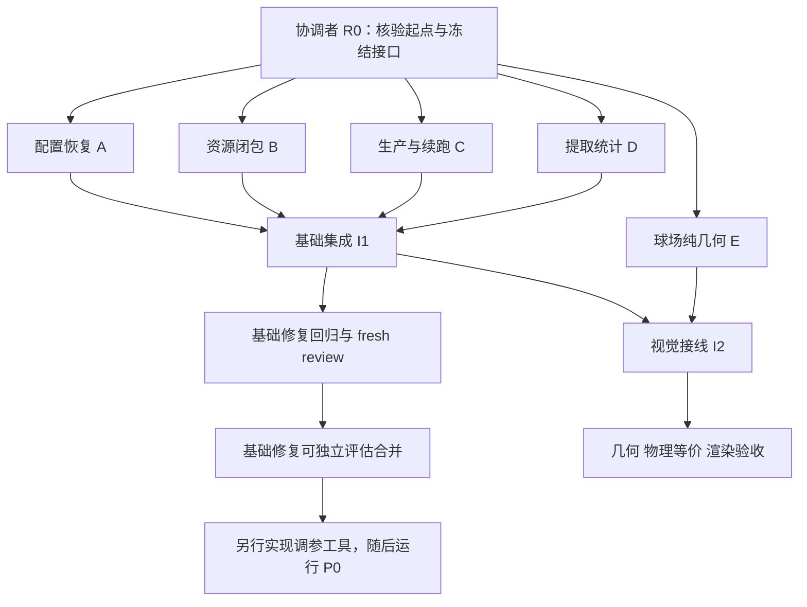

# R1D × V12 并行修复 Implementation Plan

> **For agentic workers:** 执行时使用 `subagent-driven-development`（推荐）或 `executing-plans` 技能逐任务推进；复审使用 `requesting-code-review`。勾选项表示未来执行步骤，本次仅设计存档。

**Goal:** 关闭复审中的 8 项 P2 和日志追溯问题，形成可以单独合并的基础修复；另行完成标准球场白线展示，为后续多 worker 调参准备可靠的数据与再现基础。

**Architecture:** 按文件独占权拆成运行配置 A、产物与资产 B、批量生产 C、统计消费 D、球场几何 E 五条工作线。先冻结共享接口，再并行实现，最后由协调者处理少量跨文件接线；同一个大文件不分给多个同时运行的代理。

**Tech Stack:** Python 3.11+、MuJoCo 3.9+、NumPy、pytest、现有 YAML/JSON/CSV/NPZ 产物；Windows 为本次已验证环境，保留 POSIX 路径兼容。

**Spec:** 本文第 2–4 节是独立可读的修复契约；后续实验见 [多 worker 调参设计](experiments/design/r1d_v12_parallel_tuning.md)，现有边界见 [使用文档](r1d_v12_usage.md) 和 [T7 报告](experiments/reports/2026-11-18-r1d-v12-parity.md)。

日期：2026-11-20。状态：**已实施并提交（F01–F08、N01、V01 全部闭环），未开始调参**。实施记录见第 15 节。

## Global Constraints

- 起点是 `feat/r1d-v12-parity` 的 `8a0326586bd35e09be31b6eddc62a5fef9eceb1a` **加当前未提交的修复及新增测试**；不能只检出该提交而丢失工作区修复。
- 执行开始重新记录 HEAD、dirty diff、未跟踪相关文件和逐文件摘要。历史证据不能代替对执行起点的核验。
- Python 函数有类型注解，公有函数有中文 Google 风格 docstring，代码注释与设计说明使用中文；路径通过 pathlib 处理。
- 保留 RM65 默认行为、旧产物兼容策略和已修安全终止行为；不修改历史 `experiment_data/exp*`、`paper/` 或 T7 冻结结果来让测试通过。
- 安全拒绝后不额外推进物理步；合并前修复不扩大安全限值、不做参数搜索。
- 默认复用当前 checkout，按文件独占权协作。共享工作区只有协调者操作 Git index/提交；子代理不得 reset/stash/checkout、改他人文件或自动回退已有修改。
- 若执行时采用独立 worktree，先建立包含用户修复的完整起点，再通过环境提供的 worktree 工具创建；不能从旧 HEAD 分叉后声称包含当前修复。
- 计划归档在可跟踪的 `docs/` 路径。`results/`、`docs/superpowers/`、`.superpowers/` 被忽略，故其中历史评审只作补充证据，本文包含执行所需的完整缺陷描述。

## Review Focus

1. 保存值、未传值和显式 `False/0/None` 容易混淆：A 验证恢复后的实际执行限制，而非仅 JSON 字段相等。
2. 中文路径、跨盘迁移、旧 source 仍存在但内容变了：B 验证最终加载字节与校验选中的资源完全一致。
3. 数据根与运行根不相邻、换输出目录续跑、两种 mode 同 seed：C/D 验证真实 CLI 到最终 JSON，不能仅测内部函数。
4. 全 miss、缺 verdict、重复任务和错误行：D 保留样本数及缺失原因，拒绝重复身份，推断不可估计时明确 null。
5. 新白线几何正确但破坏历史快照或物理接触：E/I2 验证外缘尺寸、无碰撞、旧模型加载与同输入轨迹一致。

---

## 1. 审查起点与交付边界

2026-11-20 复审对当前工作区跑得 `12 failed / 1693 passed / 4 warnings / 3 errors`，379.97 s；15 个失败/错误 ID 与前次基线相同，两模式 seed42 冻结验收及 RM65 两模式对拍通过。这个结果只描述该次工作区，不是本计划实施后的结果。

两项旧 P1 已关闭：安全停止后补步为 0，Windows 日志文件可以创建。仍有下列 8 项 P2；基础修复关闭后可以独立评估合并，无需把上万回合调参和球场外观都塞进同一次合并。球场是既有模型的视觉几何问题，不伪称本次修复引入。

历史复现证据位于 `results/r1d_v12_parity/reviews/rereview_2026-11-20/` 的 `review.md`、各 `*_probe.py`、`*_evidence.json`、`pytest_full.log`、`test_comparison.json`。该目录可能不随仓库分发；下面的数值、输入及验收足以重建回归，不把其存在作为实施依赖。

## 2. 修复契约与责任映射

| ID | 已复现行为 / 需要达到的行为 | 主要入口 | 负责人 |
|---|---|---|---|
| F01 P2 | 保存→恢复→执行后 `max_tcp 0.45→1.8`、豁免步 `4→20`、dq 比例 `0.2→0.5`、球速扰动 `10→0`、常开碰撞 `true→false`；恢复执行及 replay 必须消费保存的有效覆盖 | `src/sim/v12_episode.py`、`v12_config.py`、replay 接线 | A，I1 接线 |
| F02 P2 | 验证可选到当前仓库正确网格，物化却加载旧 source；旧源 STL 放大 1.25 倍仍通过验证，mesh 差 0.0857043；验证和加载必须同源 | `src/sim/episode_artifacts.py` | B |
| F03 P2 | output 与 data-root 分离时，两条 active 被最终统计为 denominator=0、missing=2；必须显式传 catalog 并按真实 artifact 位置提取 | 两个统计脚本、paper smoke 生产端 | C + D，I1 验收 |
| F04 P2 | 同 speed/seed 的 torque 2 active、position 2 miss 被合成 4 样本 50%，且配对可覆盖；应分别 100%/0%，重复键拒绝 | `scripts/extract/paired_stats.py` | D |
| F05 P2 | manifest 稳定 config_id 未送入 batch，换 output 后 TCP1.0 两条重复，4 行变 6 行；路径变化不应改变逻辑任务身份 | `scripts/exp/batch_runner.py`、paper smoke | C |
| F06 P2 | R1D manifest 已有 exp17d 四档，E3 却先找不存在的 exp17a_noise，输出空表；改读实际声明来源，保留 RM65 旧来源 | `scripts/extract/paired_stats.py` | D |
| F07 P2 | E8 physical DiD 全 miss 输出 `[0,0]`、p=1，没有不可估计原因；保留观察差值/样本数，推断字段 null+all_miss | `scripts/extract/paired_stats.py`、table2 消费 | D |
| F08 P2 | 自定义兄弟片段 + 非空 fixed_joint_poses 保存回放，左肩 body_pos X 从 0.2 变 0；实际消费的装配依赖必须完整保存 | `episode_artifacts.py`、`model_factory.py` | B |
| N01 P3 | manifest 的 136 个 log_path 与实际安全文件名全不符，CSV 路径正确；规划、执行共用日志路径函数 | paper smoke、batch | C |
| V01 独立改进 | 现有双打线方向错误、底线±6 m、缺单打线等；增加标准无碰撞球场展示并保留 legacy | `model_factory.py`、新几何模块 | E，I2 接线 |

## 3. R0 先冻结的跨任务接口

这些是**拟新增接口**，不是声称现有代码已具备。协调者先把类型、序列化样例和函数签名交给各代理；实现属于下列唯一 owner，其他代理可以先基于样例写测试。接口改变必须通知消费方。

### 3.1 有效运行覆盖（owner A）

新增 `src/sim/episode_runtime.py`，不导入 `episode_artifacts`，避免循环依赖：

```python
resolve_runtime_options(
    config: ResolvedV12Config, explicit: Mapping[str, Any]
) -> ResolvedV12Config
apply_runtime_limits(
    config: ResolvedV12Config, bundle: V12RobotBundle
) -> ResolvedV12Config
```

第一函数返回独立的新配置，`explicit` 只包含调用者真的传入的键；优先级为当前显式值 > 已保存值 > 旧默认。`run_v12_episode` 对覆盖参数使用内部 `UNSET` 哨兵，不能用 bool/0/None 判断是否提供。CLI 已有显式参数集合，转发时只传显式键；其他旧调用仍获得原默认行为。

约定：bool 字段显式 False、数值字段显式 0 是覆盖，不是缺省；可空字段显式 None 表示清除对应覆盖、采用该字段旧默认；不允许 None 的字段明确报错。允许清除的字段为 `hit_direction/limits_config/max_tcp/terminal_exempt_steps/dq_max_fraction`。清除 limits_config 仅移除文件层覆盖，单独显式给出的 max_tcp 等仍生效；保存值被清除后其衍生的 effective 字段必须重新计算。

保存的 limits 文件内容及 SHA256 与实际有效 qdot/dq/TCP/init_q 一同存档。恢复时消费已验证的内容，不要求原绝对文件仍存在；显式传入新 limits_config 才重新读取新文件并重算。不能同时把旧 effective 值与新文件值各应用一次。`build_v12_robot` 后、reset/首 plan 前调用同一个 `apply_runtime_limits`，它同时更新 bundle 并返回含实际 effective 值的新配置；执行、结果、快照全部使用此返回值，replay 也调用它。无覆盖字段的旧 artifact 保持原默认兼容。

### 3.2 已验证资源（owner B）

在 `episode_artifacts.py` 定义：

```python
resolve_verified_assets(
    snapshot: Mapping[str, Any], project_root: Path
) -> dict[str, Path]
```

key 是 snapshot 内稳定的资源逻辑 ID（不能以某次绝对路径作 ID）。返回值仅包含内容哈希匹配的资源；缺失/损坏报带逻辑 ID 的错误。原 `_verify_model_assets` 可保留兼容包装，但物化必须直接消费同一映射；复制到临时目录后再次验证复制字节，不能重新挑选旧 source。文件句柄/临时目录生命周期覆盖 MuJoCo 的全部加载过程。

新增快照依赖字段采用 `dependency_manifest_version=1`，保留现有 episode v2 读取。资源包括模板、profile、include、网格以及工厂实际读取的兄弟片段；记录依赖角色、相对位置、内容哈希和定位候选。新产物禁止缺依赖时悄悄回退仓库同名文件。旧产物无该字段时走明确的 legacy 兼容分支及已有警告，不假装已验证完整闭包。

传递链也在 R0 冻结：B 在 `RobotModelBundle` 增加 `dependency_manifest: tuple[dict[str, Any], ...]=()`，每项为 JSON 原生值，包含 `asset_id/role/relative_path/source/sha256`；装配时读取的 XML/片段另存 `content_base64`，mesh 记录当时的哈希与来源，writer 复制前再验证。A 在 `V12EpisodeResult` 增加默认空 `model_dependency_manifest: list[dict[str, Any]]`，使测试构造器兼容。I1 将实际 bundle 清单深拷贝进结果的所有正常/提前失败返回路径；B 的 writer 消费该字段，不能在回合结束后重新扫描当前仓库来推测本次读了什么。新 R1D 生产结果缺清单必须报错；旧文件读取与测试显式 legacy fixture 的兼容不能伪装新产物。该通道不向结果塞入活的 MuJoCo/bundle 对象。

### 3.3 稳定任务 ID、目录 catalog（owner C）

`ExperimentSpec` 的每个参数记录新增保留元数据 `_config_id`，携带 manifest 已算出的稳定 ID。CLI 构造、config 内容摘要必须剔除所有内部元数据；resume、CSV、日志使用同一 `_config_id`。旧调用没有它时保留原 make_config_id 路径。显示 argv 可以含绝对 runtime 快照路径，身份键使用配置内容摘要。

在 `batch_runner.py` 暴露 `task_log_path(log_dir: Path, experiment: str, config_id: str, seed: int) -> Path`；使用 Windows 合法、长度受控且包含摘要的文件名，manifest 与真实写日志共用。旧记录兼容识别但不自动合并冲突身份。

新增 `scripts/exp/run_catalog.py`，owner C 提供纯解析类型：

```python
load_catalog(path: Path) -> RunCatalog
resolve_catalog_path(catalog: RunCatalog, value: str) -> Path
```

`RunCatalog` 包含 `schema_version=1`、`catalog_path`（加载后补入）、`robot_id`、`run_root`、`data_root`、`runs_csv`、`manifest_path`、`source_sets`。JSON 路径相对 catalog 文件解析，绝对路径也接受；runs.csv 中 artifact_dir/log_path 的相对路径以 catalog.run_root 为基准，此规则写入 `path_base=run_root`。`source_sets` 至少声明 `nominal_mechanism` 对应的实验目录名：R1D 为 `exp17d_mechanism`；旧 RM65 无 catalog 时保持旧逻辑。producer 在 output 根写 `catalog.json`，向所有提取/统计子命令传 `--catalog`。

换 output 续跑不搬移旧数据：已完成任务的 artifact/log 位置以原 CSV 的实际路径为准，先按原记录的基准解析，再写成新 catalog 下正确的相对引用；跨盘不能相对表示时写绝对路径。协调器以这些实际路径回填新 resolved manifest 和 runs.csv；另存 `planned_artifact_dir/planned_log_path` 仅作计划信息，不能当作已存在文件。新任务仍使用新 run_root。原 output 必须保留；已完成记录的产物缺失/摘要不符时明确报错，不改用新计划路径、不自动重跑覆盖。N01 的三方路径一致指解析后的实际文件位置相同，不要求相对路径字符串逐字相同。

显式 catalog 不存在、声明文件冲突或内容身份不匹配时退出非零，不能继续猜父目录捡到旧数据。旧入口没有 catalog 时只接受无歧义的旧布局；找到多份不一致 runs.csv 要报错，不能“第一份胜出”。

### 3.4 分模式统计（owner D）

两个提取入口新增 `--catalog PATH` 和 `--mode torque|position|both`。单模式保持既有 JSON 内部结构；原无 mode 调用仅在数据中恰好一种模式时自动推断，混合模式必须明确选择。旧 RM65 可从既有 actuator/position-mode 配置推断，不默认把未知值当 torque。

保留两个 CLI 既有的 `--output` **目录**语义。`paired_stats.py --mode both --output stats` 分别写 `stats/torque/{06-stats-active.json,paper_stats_active.json}` 与 `stats/position/` 下同名文件；`stats/modes.json` 仅作 `paired_stats_multi_mode_v1` 索引（mode→目录）。per-case 提取写 `stats/<mode>/<experiment>/<case>.json`。显式单模式仍写既有目录结构，不能改变现有脚本的参数含义。producer 的 table/plot 后续依赖分别消费两个单模式目录，不能把索引交给旧绘图器；其命令替换、expected_outputs 和日志身份也应分 mode。

`compute_summary` 及 case 统计 API 增加可选 keyword `catalog_path: Path | None=None, mode: str | None=None`；内部逐层传入不可变上下文，不用进程全局变量或 monkey-patch load。统计选择先验证 robot/racket/来源身份与 mode，再配对。唯一记录键包含 experiment、case、config_id、seed、mode、robot/racket/source 身份；重复直接报错，不用 dict 静默覆盖。比较组之间允许 tier/限速/候选不同，配对键是同分层内的 case/input 身份（旧数据用 seed），不能因把组间配置 hash 放入 join key 而消灭配对。

注意两个数据视图不等于两次任务：catalog 的 runs.csv 是富化后的权威逐任务视图，results.csv 是同一记录的基础字段/一致性对照，不能纵向拼接后计两次。先分别检查每个来源内部唯一性，再按完整身份一对一连接，核对共有科学字段一致，物理判定消费 runs.csv/其指定 artifact。跨视图相同身份是预期情况，单一来源内重复或跨视图科学字段冲突才报错。manifest 预期任务缺富化行时报告 missing，不悄悄丢样本或从其他目录补数据。

table2 的实际 LaTeX 消费也归 D：`scripts/plot/paper_figs.py` 新增 `--hit-semantics legacy|physical`，默认 legacy 保持旧 RM65；C 的 R1D table 依赖显式传 physical，读取 `summary.physical` 中相应 E3/E8 并显式标注口径。null 的区间/p 值显示 `--`、保留原因，不直接解包 None；不能只修 JSON 让实际输出继续读 legacy。图表中其他需要完整数据的入口仍按既有不足即跳过契约，不能为新表补造数据。

## 4. 并行划分、文件所有权与依赖

| 工作线 | 独占写入文件（路径均相对仓库根） | 暂不得改的共享入口 |
|---|---|---|
| A 运行覆盖 | 新 `src/sim/episode_runtime.py`；`src/sim/v12_episode.py`、`src/sim/v12_config.py`、`scripts/rm65_mpc_v12.py`；新 `tests/test_v12_runtime_restore.py`；现有 `tests/test_v12_runtime_overrides.py` | `episode_artifacts.py` 留待 I1 调用其接口 |
| B 资源闭包 | `src/sim/episode_artifacts.py`、`src/robot/model_factory.py`；新 `tests/test_episode_asset_closure.py`；现有 `tests/test_episode_replay_sources.py` | 不改 A 的 episode/config；不做白线布局改造 |
| C 生产与续跑 | `scripts/exp/batch_runner.py`、`scripts/exp/run_r1d_paper_smoke.py`、新 `scripts/exp/run_catalog.py`；`configs/experiments/r1d_paper_smoke.yaml` 的数据/输出命令模板；新 `tests/test_paper_run_identity.py`；现有 `test_batch_runner_logs.py`、`test_paper_smoke_data_root.py` | 不改统计大文件；不改 manifest 的实验物理条件与 seed |
| D 提取统计 | `scripts/extract/paired_stats.py`、`scripts/extract/extract_r1d_smoke_stats.py`、`scripts/plot/paper_figs.py` 的 table 口径/空值消费；新 `tests/test_paper_stats_catalog.py`；现有 `tests/test_paired_stats_semantics.py` | 不改 producer；CLI 参数转发由 C 完成 |
| E 球场几何 | 新 `src/robot/court_geometry.py`、新 `tests/test_court_geometry.py` | 不改 `model_factory.py`、runtime/config、旧 XML 与旧场景测试，交给 I2 |
| I 协调集成 | 各线交还文件后才接手；跨线测试、场景接线、文档/索引、最终 Git 操作 | 接手前确认原 owner 停止写入 |

F03 依赖 producer/consumer 一致，但 C/D 的实现和合成测试可以按第 3 节契约并行。F03/F04/F06/F07 集中在 `paired_stats.py`，故统一归 D，内部顺序完成；不为了代理数量拆成四个人改同一个文件。E 先交付纯几何模块，等 B 释放工厂再接线。



有 4 个并发槽位时保留协调者 + 3 个 worker：第一波 A/B/C；任何一条释放槽位后优先 D，再 E。这不是要求等整波结束；D 在 C 接口未完成时可用冻结 catalog 样例开发。若可用槽位更多，R0 后五线可同时启动。I1 与 I2 顺序执行，避免共享文件竞争。reviewer 占一个槽位，优先在对应 owner 交付后启动。

## 5. R0 — 起点和调度准备（协调者）

- [ ] 核验当前 branch/HEAD、diff 和未跟踪测试，保存起点清单；若已经有后续修复，逐项核验后调整本文任务，不重复覆盖。
- [ ] 核对第 3 节接口与当前签名，向 A–E 发同一版本；任何接口变动先改契约再通知消费者。
- [ ] 使用一个小型 synthetic catalog/manifest 样例统一 config_id、path_base、source_sets 和单/双模式输出。样例由协调者写入 `tests/fixtures/r1d_review_contract/`，不依赖 ignored 证据目录。
- [ ] 设立文件独占表和状态清单，记录每条线的 allowed files；明确共享工作区子代理不提交，协调者在独立验证后按工作包暂存/提交。
- [ ] 给每个代理只提供本计划、对应任务、项目规范和必要源文件，使用全新上下文；不要让它继承“上一轮 PASS”作为结论。

## 6. A — 运行参数恢复（F01）

**Interfaces:** 消费 `ResolvedV12Config` 与 `V12RobotBundle`；交付第 3.1 节两个函数，以及供 I1 调用的 replay 约束行为说明。执行路径必须先 resolve，再 build/apply/reset；写入产物的 config 就是实际消费的 config。

- [ ] 在 `tests/test_v12_runtime_restore.py` 写失败回归：实际运行时设置 max_tcp=0.45、terminal_exempt_steps=4、dq_max_fraction=0.2、ball_speed_perturb_pct=10、always_collision=True；序列化/还原后不传 kwargs，捕获首 plan 的 limits、碰撞设置和来球，必须一致。不能只用 0 步早退验证。
- [ ] 补充显式覆盖优先级：False 覆盖 True、0 覆盖非零、UNSET 继承、允许字段 None 清除；删除原 limits 文件后仍可从快照内容恢复；新文件显式覆盖不保留旧衍生 effective 值。
- [ ] 跑新测试确认旧代码失败，保存实际失败原因；若当前已经通过，先证明为何不再触发，不制造假失败。
- [ ] 实现 `episode_runtime.py`，迁移必要的共享解析逻辑，更新 run API 与 CLI 显式转发；保留无覆盖时的 RM65/R1D 默认值，并添加第 3.2 节约定的结果清单字段供 I1 接线。
- [ ] 运行 `python -m pytest tests/test_v12_runtime_restore.py tests/test_v12_runtime_overrides.py tests/test_v12_config.py -q`，预期全部通过。
- [ ] 提交交付摘要给协调者：改变文件、真实消费值证据、接口和回归结果；等待 I1 replay 消费测试，不能提前宣称 F01 全闭环。由协调者按文件提交 `fix: restore effective episode runtime options`。

## 7. B — 资源校验与装配闭包（F02/F08）

**Interfaces:** 第 3.2 节资源映射和依赖清单。工厂记录实际读取的装配片段供 snapshot 保存；不对文件系统做无边界递归扫描。以真实解析/装配访问路径收集依赖，解析相对 include/mesh 的基准与 MuJoCo 当前模型一致。

- [ ] 在 `tests/test_episode_asset_closure.py` 构造正确 repo 网格、指向旧检出的 source；分别删除旧 source、把旧 STL 合法缩放 1.25 倍。验证通过后实际加载只能使用正确字节，模型数组与保存前一致，或明确拒绝；不能出现“verify=[] 但加载错文件”。
- [ ] 构造外部模板目录与自定义 `r1d_arm_left.xml`，将 left_shoulder_pitch_Link 的 X 设为 0.2，runtime.fixed_joint_poses 非空；立即保存/回放必须保留该值。再移动来源目录、删除外部片段验证快照闭包。
- [ ] 增加中文路径、跨根资产、嵌套 include、损坏已验证文件在复制前被更换、缺失新依赖、旧 artifact 无依赖清单六类测试；损坏的新快照明确报错，不退回当前仓库。
- [ ] 运行新失败回归；实现统一映射，物化只用其文件，复制后校验摘要；保存/恢复真实兄弟片段并维持临时资源生命周期。
- [ ] 运行 `python -m pytest tests/test_episode_asset_closure.py tests/test_episode_replay_sources.py tests/test_episode_artifacts.py tests/test_multi_robot_replay.py tests/test_r1d_model.py -q`，预期通过这些相关测试。
- [ ] 向协调者移交文件所有权与依赖格式说明，由协调者提交 `fix: replay verified model dependency closure`。E/I2 此后才可改 model_factory。

## 8. C — 任务身份、catalog、日志（F05/N01/F03 生产端）

**Interfaces:** 第 3.3 节 `_config_id`、`task_log_path`、`RunCatalog`；向 D 提供至少一个真实 producer 生成的 catalog，以及 artifact_dir 相对路径解析规则。

- [ ] 写 `tests/test_paper_run_identity.py`：同一 manifest/data_root，output 从 plan_a 换 plan_b，第一次 exp16 为 4 行，续跑必须 `launched=0` 且仍 4 行；运行参数内容变化时新身份必须变化并按原隔离契约拒绝混写。
- [ ] 验证新 `_config_id` 不进入 CLI 参数、不被再用路径重新计算；旧无 `_config_id` 调用仍兼容；同 seed 不同 mode/robot/racket 不误去重。
- [ ] 写日志追溯回归：使用真实 manifest 的全部任务，manifest.log_path、CSV.log_path 解析到同一实际文件；Windows 文件名合法、唯一且长度受控。换 output 且 launched=0 后也回填到旧目录中的真实文件，不只核对首次运行。
- [ ] 写 catalog 回归：output/data_root 相隔多级或跨盘；相对 artifact_dir 正确基于 run_root；移动整棵目录仍能解析；显式坏 catalog 不回退旧数据。
- [ ] 跑失败回归，再实现元数据贯穿与统一日志路径、catalog 生成、统计子命令 `--catalog/--mode` 转发。F03 消费尚未完成时不要声称端到端闭环。
- [ ] 运行 `python -m pytest tests/test_paper_run_identity.py tests/test_batch_runner_logs.py tests/test_paper_smoke_data_root.py tests/test_r1d_paper_pipeline.py -q`；纯 producer 测试应通过，依赖 D 的新接口留给 I1 集成门禁。
- [ ] 返回稳定 ID 样例、catalog 与变更文件，由协调者提交 `fix: unify batch identity and explicit result catalog`。

## 9. D — 最终统计契约（F03/F04/F06/F07）

**Interfaces:** 消费 C 的 `RunCatalog` 与第 3.4 节模式接口；产出兼容的单模式 JSON 和双模式索引。此任务内部按“数据定位 → 模式与唯一性 → E3 来源 → DiD 不可估计”顺序推进，各子步骤有独立行为断言。

- [ ] 在 `tests/test_paper_stats_catalog.py` 使用真实 manifest 的任务结构和明确标记的合成结果：任意 output/custom_csv 两根，两条 active 应最终 denominator=2、rate=100.0、missing=0；同时覆盖 per-case 提取器的 physical_active_rate=100.0。保持既有百分数单位。
- [ ] 写 mode 回归：相同 seeds 的 torque 2 active、position 2 miss，paired_stats 最终分别 denominator=2、rate=100.0/0.0；both 生成两个独立统计目录及索引；未指定模式且输入混合应非零退出；单源内重复同身份样本报错，results/runs 两视图一对一连接不重复计数。per-case 全 miss 保留既有 null+all_miss 契约，不把这项修复扩成历史口径重定义。
- [ ] 写 E3 回归：只有 manifest 声明的 exp17d_mechanism 四档也能生成完整 E3；不存在的 exp17a_noise 不阻断。另保留旧 RM65 数据源测试，不能借用其他 root 的旧实验补数。
- [ ] 写 E8 回归：TCP1.0/1.8 × 四档 × seeds100/101 全 miss 时，最终 physical DiD 保留样本量/观察差值 0，`ci95=null`、`p_sign=null`、`unavailable_reason=all_miss`；调用实际 paper_figs table 入口，table2 显示 `--` 并可追溯原因。混合 miss/hit 的正常配对仍给有效统计；默认 legacy 表输出维持兼容。
- [ ] 加入 missing verdict、error、无公共 seed 的原因区分；历史统计口径与新调参的全任务分母不能混为一谈，不在此次修复中偷偷改写所有历史表定义。
- [ ] 分别运行失败回归、实现最小改动，再运行 `python -m pytest tests/test_paper_stats_catalog.py tests/test_paired_stats_semantics.py tests/test_r1d_paper_pipeline.py -q`。
- [ ] 直接调用两个真实统计 CLI，检查最终 JSON 和表格；内部函数通过不算交付。向协调者交付，由其提交 `fix: preserve mode and physical verdicts through paper statistics`。

## 10. E — 标准球场白线模块（独立视觉工作包）

**Files:** 只新建 `src/robot/court_geometry.py`、`tests/test_court_geometry.py`，不修改自动生成的 `r1d_model_left/right.xml`。新模块不 import MuJoCo，不包含机器人位置或物理材料。

**Interfaces:** 定义不可变 `CourtLine(name: str, center: tuple[float,float,float], half_size: tuple[float,float], rgba: tuple[float,float,float,float])`；`build_court_lines(profile: str) -> tuple[CourtLine, ...]` 接受 `legacy_v1` / `itf_2026_v1`，未知值报错。工厂将其转成现有无碰撞薄 plane；半尺寸、轴向和 Z 深度由模块明确输出，不能让装配端再次猜测。

当前地面白线不只是颜色问题：双打线长轴仍沿 Y，重叠成 X=0、Y=-17..17 的 34 m 中线；底线 X=±6 m，发球线 X=±3 m，缺少正确单打矩形；线宽 0.1 m。标准依据为 [ITF 2026 Rules of Tennis，第 1 条](https://www.itftennis.com/media/7221/2026-rules-of-tennis-english.pdf)。本方案统一普通线和底线宽 0.05 m，符合尺寸范围，按外缘量取场地尺寸。

| 元素 | 几何契约（X 为场长方向，网平面 X=0） |
|---|---|
| 双打矩形外缘 | X=±11.885 m、Y=±5.485 m，23.77 × 10.97 m |
| 单打边线外缘 | Y=±4.115 m，宽 8.23 m；从一端底线到另一端 |
| 底线中心 | X=±11.860 m，宽 0.05 m，跨双打宽度 |
| 双打边线中心 | Y=±5.460 m，宽 0.05 m，沿 X 延伸 |
| 单打边线中心 | Y=±4.090 m，宽 0.05 m，沿 X 延伸 |
| 发球线 | 外缘 X=±6.400 m、中心±6.375 m，止于两侧单打边线；不能伸入双打巷 |
| 中心发球线 | Y=0、宽 0.05 m，只在两发球线之间，不贯穿底线外 |
| 底线中心标记 | Y=0、宽 0.05 m、向场内长 0.10 m，从底线内缘起计算，禁止朝底线外延伸 |
| 网与纹理 | 地面不画横贯 X=0 的十字线充当球网；移除新 profile 的白色棋盘边缘伪线，保留中性地面材质，不新增有碰撞的网 |

新 profile 每个可见线段有稳定名称；交点相接且没有缝隙/重复闪烁。标准布局可拆成 12 个线段（2 底线、2 双打边线、2 单打边线、2 发球线、2 中心发球线、2 中心标记），不以数量替代尺寸正确性。legacy_v1 保留旧 10 线的实际几何和输出顺序。

- [ ] 写几何失败测试：外缘长宽/线宽、公制单位、X/Y 主轴、发球线端点、中心线范围和两个中心标记；用解析预期数值断言，不复制实现循环。
- [ ] 写 legacy 回归：旧 10 线的 center/half_size/颜色顺序不变；未知 profile 拒绝。
- [ ] 实现纯布局生成器，固定白线高于地面的小偏移沿用现有安全视觉约定，所有白线计划 `contype=conaffinity=0`。
- [ ] 运行 `python -m pytest tests/test_court_geometry.py -q`，预期通过；将模块交给 I2，不私自改 model_factory 或更新旧测试为全绿。
- [ ] 由协调者提交 `feat: add standard tennis court line geometry`；该提交只提供模块，不宣称 UI 已使用新球场。

## 11. I1 — 基础集成（协调者，A/B/C/D 已停止写入）

- [ ] 接入 replay 的 `resolve_runtime_options/apply_runtime_limits`，复用 A 接口；在新 `tests/test_v12_review_integration.py` 验证 config 保存→还原→实际执行→保存→回放的完整链，比较实际 constraints 与有效配置。
- [ ] 按第 3.2 节接通 `RobotModelBundle → V12EpisodeResult → writer`，包含正常及提前失败结果；检查清单覆盖 A 解析后实际消费的配置，显式 overrides 不会错误改变原保存模型源。用真实 episode 保存验证，不止手工构造结果对象。
- [ ] 用真实 paper manifest + 合成结果跑 producer→custom data_root→extract→paired_stats→table 全链，覆盖两模式、136 任务、E3 四档、E8 全 miss；所有 synthetic 数据明确标注，不作控制效果证据。
- [ ] 再将 output 迁移后续跑，确认没有额外 launch 和重复行；核对 manifest/CSV/实际日志路径逐条一致。
- [ ] 运行相关测试集合后，执行一次全量：`python -m pytest tests/ -q -p no:cacheprovider --tb=short`，设置 `PYTHONUTF8=1`、`PYTHONDONTWRITEBYTECODE=1`，使用 `mujoco_tennis` 环境。预期没有新增失败/错误 ID，基线 12F+3E 单独披露；若其中有意修复，说明 ID 为何消失。
- [ ] 核验全量结果包含 R1D seed42 两模式硬验收、RM65 两模式 T0 对拍、安全终止、回放前馈和原修复新增测试；不重复运行已经通过的昂贵验收，除非后续改动影响它们。
- [ ] 交 fresh reviewer 审基础修复的最终 diff 与实际测试证据，逐 F01–F08 判闭环；未关闭的 P2 继续修复，不能只报 passed 数量。
- [ ] 协调者整理基础修复提交及报告；此时可单独交付合并审查。大规模调参不是本项合并前置条件。

## 12. I2 — 球场展示接线与验收（协调者接管共享文件）

**Files:** `src/robot/runtime_parameters.py`、`model_factory.py`、`src/sim/v12_config.py`、必要的 `v12_robot_adapter.py/episode_artifacts.py`、`scripts/tools/inspect_robot_model.py`、新 `configs/robots/r1d_v12_runtime_right_itf.yaml`、`tests/test_r1d_v12_scene.py` 及新 `tests/test_court_scene_integration.py`。工具路径已核实；不要手改 generated XML 或 legacy `rm65_model.xml`。

新增 `SceneParameters.court_profile: str='legacy_v1'`，解析器只接受两种 profile。保存/还原明确包含视觉 profile 和几何版本；旧 YAML/旧 artifact 缺字段时为 legacy。新 runtime 文件完整复制当前 R1D runtime 数值并仅追加 `scene.court_profile: itf_2026_v1`，测试证明除该字段外完全一致；文档给出选用这个 runtime 的预览/仿真命令。现有 T7 冻结命令不改默认，后续需要默认标准展示时另做明确切换。

- [ ] 将工厂旧 `_COURT_LINE_GEOMS` 生成接到 E 模块，legacy 分支保持既有输出；标准分支按具名线段生成，碰撞掩码保持 0。
- [ ] 新增 profile 解析、有效配置、快照序列化与回放消费测试；新快照缺/改该字段的身份变化可追溯，不能混用旧 snapshot hash。
- [ ] 调整 `test_r1d_v12_scene.py` 中“无 ITF 元素、必须旧 10 线”的断言，仅对 legacy 分支保留；为标准 profile 新增实际模型几何断言，不整体删除旧回归。
- [ ] 比较相同控制序列、相同来球、相同机器人初态的 legacy/standard 执行，X/U、球状态、接触事件和碰撞参数一致；基座仍 `[-12.5,-0.8,0.155]`，不为配图移动机器人或修改发球。可只跑有判别力的短轨迹与冻结接触案例，不需重做上万回合调参。
- [ ] 用真实 MuJoCo 渲染俯视全场、机器人近景、低角度三视图，检查边线方向、服务区四格、线宽、中心标记、地面伪白线与深度闪烁。截图归档并由 reviewer 看图，不能用示意图代替实际渲染验收。
- [ ] 独立 review 视觉 diff、几何测试和物理等价结果，更新 `docs/r1d_v12_usage.md`、源模块/脚本索引，单独形成可审查提交。

## 13. 可直接交给 subagent 的任务模板

协调者复制模板，为每条工作线替换 ID/allowed files/所需接口；完整任务细节以本文件对应章节为准。

```text
你负责 R1D×V12 修复工作线 <A/B/C/D/E>，只执行该工作线。
先读 AGENTS.md、本计划 Global Constraints、第 2–4 节及你的任务章节。
起点是协调者给出的当前工作区快照，含已有未提交修复；不能回退到旧 HEAD。

目标：<该工作线对应的问题及验收结果>。
允许修改：<从 ownership 表逐项复制文件，含独占新测试文件>。
消费接口：<第 3 节对应签名/JSON 样例>。
交付接口：<提供给后续代理的函数/类型/行为>。

其他代理可能同时工作：只改允许文件，不修改共享 Git index，不提交，不重置、
不删除他人变更，不扩大任务为全仓重构；需要改范围外文件时先发给协调者。
先写可复现失败的行为测试，再做最小修复，跑该任务约定测试。
数据根使用独立临时目录，禁止覆盖已有实验；不要开展参数搜索。

返回：根因；逐文件改动；实际失败→通过命令及结果；接口变动；仍未覆盖的风险；
是否已停止写入并可移交文件所有权。不能仅返回“PASS”或“已完成”。
```

实现代理交付后可并行安排只读 reviewer。基础修复建议两位：一位查 A/B/I1 的再现与安全消费，一位查 C/D/I1 的身份与统计。球场 reviewer 独立看 E/I2 及真实渲染。reviewer 只报告可复现问题与文件位置，协调者再分配修复；不让 reviewer 直接改另一代理正在编辑的文件。

## 14. 完成检查与后续顺序

- [x] 每项 P2 都有对应失败回归和最终行为证据，F03 同时覆盖 producer 和两个 consumer，F01 包含 replay；N01 日志路径核验通过。
- [x] 无丢失用户未提交修复、无新混合模式统计、无配置来源静默回退、无新安全停止后补步。
- [x] 基础修复回归对照精确失败/错误 ID，fresh review 完成；报告评审的真实提交/工作区身份，不能复用旧 HEAD 名称。
- [x] 球场可以独立完成/延期，不阻塞基础修复；若已交付，具备三视图、几何及物理等价证据。
- [x] 调参设计仍处于存档状态；只有未来明确启动后，才依 [实验设计第 10 节](experiments/design/r1d_v12_parallel_tuning.md#10-后续实现拆分与契约) 开发 T0–T4、运行 P0，再决定实际 workers 和预算时间。

## 15. 实施记录（2026-11-20）

提交链（`feat/r1d-v12-parity`）：

| 提交 | 内容 |
|---|---|
| `d721328` | R0 冻结接口夹具 `tests/fixtures/r1d_review_contract/` |
| `4d944d7` | E：纯几何 `src/robot/court_geometry.py` + 18 tests |
| `9241eeb` | C：稳定 config_id、`task_log_path`、`run_catalog.py`、producer `catalog.json` |
| `f464529` | A：`episode_runtime.py`、UNSET 哨兵、保存/恢复/执行消费、CLI 显式键 |
| `258c2f1` | B：`resolve_verified_assets`、依赖清单、兄弟片段快照、物化同源 |
| `4c202db` | D：`--mode/--catalog`、唯一键、E3 声明来源、E8 全 miss、table2 口径 |
| `51ff669` | I2：`scene.court_profile`、ITF 12 线、中性地面、三视图渲染 |
| `676d30d` | I1：replay 恢复 limits、严格依赖清单、集成测试 |
| `ca1a81e` | 冻结兼容：恢复模板注释/生成模型字节，legacy 默认不写 court 键 |
| `b5be00d` | 既有本地回归测试、用户未提交修复与两份设计文档入库 |

逐项结果：F01 保存→还原→实际执行（max_tcp 0.45 触发安全滤波/紧急停止）与 replay 消费；F02 删除旧源或放大 1.25 后仍加载校验通过的字节（顶点级对照）；F03 producer 写 catalog、extract/paired_stats 按 run_root 解析；F04 两模式分别 100%/0%，混合未指定非零退出；F05 换 output 续跑 `launched=0`、config_id 序列不变；F06 E3 只读 `exp17d_mechanism`；F07 全 miss 保留样本与观察差，`ci95/p_sign=null`、`unavailable_reason=all_miss`，table2 显示 `--`；F08 外部兄弟片段移走后 fixed_joint_poses 仍为 X≈0.2；N01 136 条日志名合法、唯一、三方同函数；V01 ITF 12 线、白线零接触、legacy 整回合逐位不变。

证据边界：F01/F02/F05/F08/N01/V01 有真实 MuJoCo 回合或真实 CLI 证据；F03/F04/F06/F07 为提交内测试 + 代码级证据，未跑真实 136 任务全链路。独立 reviewer 结论 9/9 PASS；遗留风险：ITF 产物 `model` 快照为磁盘 legacy 模板（白线由 runtime 内存重建，审计需注明）、artifact replay 仅库级 API、仓库内仍有修复前旧 smoke 产物。

最终全量（提交后干净工作树，`b5be00d` + 文档更新前）：`12 failed, 1785 passed, 4 warnings, 3 errors in 574.13s`；12 个失败与 3 个 error 的 ID 与 T0/复审基线完全一致（`test_multi_robot_mpc` 6、`test_multi_robot_sim_entrypoint` 3F+3E、`test_r1d_closed_loop` 3），无新增失败。


实施已完成并提交；本轮只关闭修复项，不包含任何调参实验或论文数据重跑。
